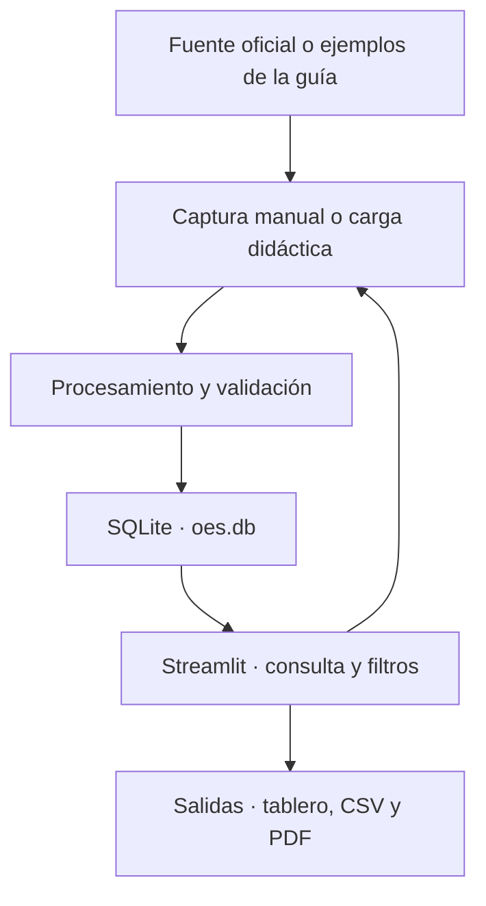

# Arquitectura y requisitos

## Alcance y contexto

El observatorio es un prototipo de monitoreo académico de educación superior peruana. La sección 1 de la guía solicita registrar, clasificar, consultar y visualizar novedades con trazabilidad. Esta arquitectura es una propuesta educativa propia; no describe la infraestructura interna de `observatorio.com.pe`.

Se implementan el nivel básico y las ampliaciones intermedias solicitadas: fecha de captura, responsable, estado de verificación, rango de fechas y PDF. Se mantiene la tabla desnormalizada prescrita para el laboratorio. La normalización de instituciones y fuentes queda como evolución, al igual que autenticación, scraping, alertas, IA y módulos de presupuesto o calidad.

## Flujo lógico

El retorno a captura representa el formulario lateral. La carga inicial no consulta internet. Una persona consulta la fuente, registra una ficha y confirma su revisión; el sistema valida estructura y unicidad. Confirmar un casillero no prueba por sí solo la verdad del contenido.

## Componentes y contratos

| Componente | Responsabilidad | Entrada | Salida o fallo controlado |
| --- | --- | --- | --- |
| `preparar_datos.py` | Crear esquema, inicializar ejemplos y registrar fichas verificadas | Ruta de base; campos validados | Base consistente; resultado de inserción o error de validación |
| SQLite | Integridad, unicidad y transacciones | SQL con parámetros | Filas con URL única y auditoría |
| `app.py` | Lectura, filtros, KPIs, tabla, formulario y exportaciones | Selección de usuario y datos de SQLite | Tablero, CSV y PDF del mismo subconjunto |
| `oes_servicios.py` | Funciones compartidas sin interfaz: lectura, filtros, KPIs, CSV y PDF | DataFrame y contexto de selección | Resultados comprobables sin iniciar Streamlit |
| `tests/` | Probar lógica y aplicación sin contaminar datos entregados | Bases temporales y ficha oficial de P6 | Resultados reproducibles |
| `.streamlit/config.toml` | Tema y configuración portable | Configuración declarativa | Apariencia consistente |

La ruta predeterminada se resuelve a partir de `__file__`, nunca del directorio actual del proceso. Se admite `OES_DB_PATH` para aislar pruebas y otras ejecuciones. No se reutilizan conexiones SQLite entre sesiones; cada operación abre, confirma o revierte y cierra su conexión. Se utiliza un tiempo de espera limitado ante bloqueos. No se cachea el contenido de la tabla, para evitar lecturas obsoletas después de registrar.

## Matriz de requisitos

| ID | Requisito de la guía | Implementación especificada | Criterio de aceptación | Pruebas |
| --- | --- | --- | --- | --- |
| RF01 | Registrar noticia con fuente, institución, fecha, título, URL y categoría | Formulario lateral con resumen, responsable y confirmación obligatoria; transacción parametrizada | Una ficha válida aparece una sola vez, conserva URL directa y tiene auditoría | P1, P6 y validaciones negativas |
| RF02 | Filtrar por categoría y texto | Selección múltiple, texto literal sin regex y rango inclusivo de fechas | Universidad pública devuelve UNMSM; PUCP devuelve una fila; término inexistente devuelve cero | P2, P3, P4 y fechas |
| RF03 | Calcular indicadores | Cantidad de noticias, instituciones distintas y categorías distintas sobre selección | Inicialmente 3/3/3; UNMSM 1/1/1; selección vacía 0/0/0 | P2–P4 y KPIs |
| RF04 | Exportar resultados | CSV con BOM UTF-8 y PDF de la selección con filtros, auditoría y URLs | Encabezados, filas y acentos correctos; no se exporta una selección anterior | P5 y PDF |
| RNF01 | Trazabilidad y ética | Fuente, fecha, URL, captura, responsable y estado visibles y exportables; aviso sobre ejemplos | Ningún ejemplo se presenta como verificado; altas sin confirmación se rechazan | Inspección, P5, P6 |
| RNF02 | Funcionamiento local sin servicios de pago | Python, SQLite, Streamlit, pandas y fpdf2; recursos de PDF locales | Arranque sin claves, credenciales, APIs ni descarga de recursos en ejecución | Arranque y recuperación |

El rango de fechas, PDF y campos de auditoría son ampliaciones de los requisitos, no nuevos RF inventados para la rúbrica.

## Política de errores y actualización

- URL inválida, fecha futura, campo vacío o confirmación ausente: explicar el problema y no insertar.
- URL duplicada: aviso comprensible y contador sin cambios; no sobrescribir la ficha anterior.
- Filtros sin coincidencias: KPIs en cero, tabla con encabezados y aviso; sin excepción.
- Rango incompleto o invertido: pedir completar/corregir; no producir resultados ambiguos.
- Base ausente, de cero bytes o tabla vacía: inicializar automáticamente los tres ejemplos.
- Base no vacía: conservar registros; no ejecutar nuevas altas didácticas por cada recarga.
- Base ilegible, corrupta o esquema incompatible: mensaje accionable; nunca borrar ni reconstruir silenciosamente datos existentes.
- Alta exitosa: reiniciar filtros al conjunto completo y recargar para que el nuevo contador sea visible. Informar este comportamiento.

## Despliegue y límites operativos

El mismo código se utiliza en Windows, Linux y Streamlit Community Cloud. Las dependencias se declaran en raíz; `sqlite3` y `pathlib` pertenecen a la biblioteca estándar. No se utiliza `packages.txt` ni un servidor de base de datos externo.

Cloud ejecuta una copia remota, independiente de la base de la computadora. Un reinicio o despliegue puede perder escrituras locales. La inicialización automática evita fallos al arrancar y reconstruye la demostración, pero no reemplaza una base persistente ni una política de respaldo. Para uso compartido institucional se requieren persistencia externa, usuarios, autorización y auditoría de cambios.

## Referencias técnicas

- Guía adjunta, secciones 1–3 y 9–12, consultada el 13 de noviembre de 2026.
- [Streamlit Community Cloud: preparación](https://docs.streamlit.io/deploy/streamlit-community-cloud/deploy-your-app).
- [Python: sqlite3](https://docs.python.org/3/library/sqlite3.html).
